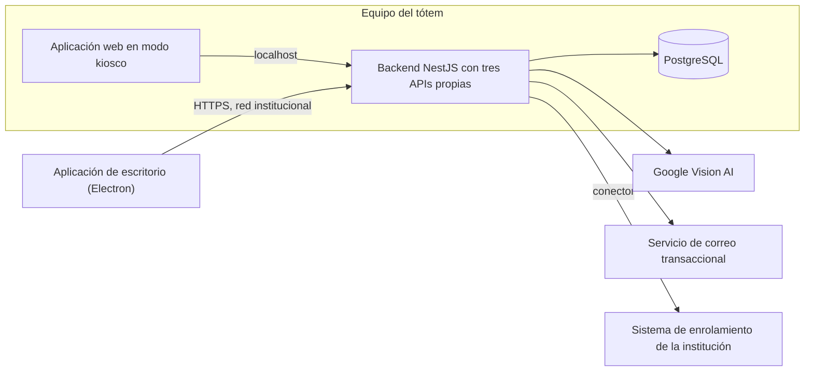

# OrientaSede (Punto Único de Información)

Tótem interactivo de orientación para instituciones educativas. Sede piloto: Duoc UC, Puente Alto.

Proyecto de la asignatura Capstone (Portafolio de Título), Ingeniería en Informática, sección CAPSTONE_704D_OLS. Docente: Julio Tapia Acevedo.

## Descripción

OrientaSede es un tótem táctil que reúne en un solo punto del campus la información que las personas necesitan para orientarse y resolver trámites sin esperar atención presencial. Permite ubicar salas, oficinas y áreas en un mapa bidimensional de cada piso, consultar el directorio de áreas de la institución, resolver dudas con preguntas frecuentes, seguir guías paso a paso de los trámites y, en las sedes que cuentan con control de acceso con identificación facial, completar de forma autónoma el enrolamiento fotográfico, que hoy requiere el apoyo de un funcionario.

Está dirigido a estudiantes, docentes, funcionarios y visitantes de una institución educativa, y a los funcionarios que mantienen su contenido desde una aplicación de escritorio. Resuelve la desorientación de quienes llegan al campus y la fragmentación de la información entre áreas como Financiamiento, Servicios Digitales, el Centro de Apoyo al Estudiante y la Dirección de Carrera, que congestionan las oficinas de atención con consultas repetitivas de baja complejidad.

El sistema se concibe como una plataforma configurable que se instala una vez por institución. El nombre, el logotipo, los colores, los dominios de correo aceptados, los planos, las áreas, las preguntas frecuentes y los trámites son datos de cada institución, de modo que adaptar OrientaSede a otra sede consiste en cambiar su configuración y sus contenidos, sin modificar el código.

## Tecnologías utilizadas

| Capa | Tecnología |
|---|---|
| Aplicación web del tótem | HTML5, CSS, JavaScript y planos en SVG |
| Aplicación de escritorio | Electron |
| Backend y APIs | Node.js, NestJS y TypeScript |
| Acceso a datos | Prisma ORM |
| Base de datos | PostgreSQL 16 |
| Verificación de identidad | Código de un solo uso enviado al correo institucional mediante un servicio de correo transaccional |
| Validación de fotografías | Google Vision AI |
| Integración con el sistema de enrolamiento | Conector con automatización mediante Playwright |
| Contenerización | Docker y Docker Compose |
| Pruebas | Jest, Supertest, Playwright y autocannon |

## Arquitectura de la solución

El sistema se organiza en tres niveles. En el primero están los dos clientes: la aplicación web del tótem, que se ejecuta en un navegador en modo kiosco, y la aplicación de escritorio con la que el administrador de contenidos mantiene la información. En el segundo está el backend, que centraliza la lógica de negocio e integra cinco APIs: tres de desarrollo propio (Enrolamiento y Trámites, Infraestructura y Salas, y Preguntas Frecuentes) y dos públicas (el servicio de correo transaccional y Google Vision AI). En el tercero está la base de datos PostgreSQL, de 32 tablas normalizadas, a la que el backend accede mediante Prisma.

El backend y la base de datos se ejecutan en contenedores Docker en el propio equipo del tótem, porque la sede piloto no dispone de un servidor. La aplicación web se comunica con el backend por localhost, y la aplicación de escritorio lo hace desde el computador del administrador por la red institucional. Los servicios externos son consumidos únicamente por la API de Enrolamiento y Trámites, de modo que la caída de uno de ellos no afecta al mapa, al directorio ni a las preguntas frecuentes.



El detalle de las decisiones de diseño, la seguridad por capas, el modelo de datos, los casos de uso y los diagramas UML se encuentra en los documentos de la carpeta de documentación, según se indica más abajo.

## Estructura del repositorio

El repositorio reúne el código del sistema, sus archivos de despliegue y las evidencias que exige la asignatura, organizadas por fase.

```
orientasede/
├── backend/               NestJS y TypeScript, con las cinco APIs
├── frontend-web/          Aplicación web del tótem
├── frontend-desktop/      Aplicación Electron de administración
├── database/
│   ├── prisma/            Esquema Prisma y migraciones
│   └── sql/               Script SQL de referencia del esquema
├── config/                Parámetros de la institución
├── docker/                Dockerfile y docker-compose.yml
├── Fase 1/                Evidencias individuales y grupales de la Fase 1
├── Fase 2/
│   ├── Evidencias Individuales/
│   ├── Evidencias Grupales/
│   └── Evidencias Proyecto/
│       ├── Evidencias de documentación/
│       │   ├── Producto/      Product Vision, Product Backlog, Definition of Done, épicas e historias
│       │   ├── Sprints/       Sprint Backlog, burndown, daily y retrospectivas por sprint
│       │   ├── Diseño/        Arquitectura, modelo de datos, UML, casos de uso, mockup y requisitos no funcionales
│       │   ├── Pruebas/       Plan de pruebas
│       │   └── Despliegue/    Manual técnico y de despliegue
│       └── Evidencias de sistema/
│           ├── Aplicación/
│           └── Base de datos/
├── Fase 3/                Evidencias individuales y grupales de la Fase 3
├── .env.example           Variables de entorno de ejemplo
└── README.md
```

## Instrucciones para ejecutar el proyecto localmente

### Requisitos previos

Se necesita Docker con Docker Compose (Docker Desktop con WSL 2 en Windows) para levantar el backend y la base de datos, y Node.js 20 o superior para ejecutar la aplicación de escritorio. La aplicación web del tótem se abre en cualquier navegador moderno. El procedimiento completo, con la configuración del modo kiosco, los servicios externos y la verificación de la instalación, está en el Manual Técnico y de Despliegue.

### Variables de entorno

Las credenciales y los parámetros de despliegue se entregan al backend como variables de entorno, y nunca se incluyen en el repositorio. El archivo `.env.example` indica las que se deben definir.

| Variable | Descripción |
|---|---|
| `TZ` | Zona horaria de los contenedores (America/Santiago). |
| `POSTGRES_USER`, `POSTGRES_PASSWORD`, `POSTGRES_DB` | Credenciales y nombre de la base de datos. |
| `DATABASE_URL` | Cadena de conexión que usa Prisma. El servidor es `db`, el nombre del servicio en Docker Compose. |
| `PORT` | Puerto en que escucha el backend. |
| `JWT_SECRET` | Clave con la que se firman los tokens de sesión del administrador. |
| `CORREO_API_KEY`, `CORREO_REMITENTE` | Credencial del servicio de correo transaccional y dirección desde la que se envían los códigos. |
| `GOOGLE_APPLICATION_CREDENTIALS` | Ruta de las credenciales de Google Vision AI dentro del contenedor. |
| `ENROLAMIENTO_CONECTOR` | Conector de enrolamiento activo, por ejemplo `click_visitas`, o `ninguno` si el módulo está inactivo. |
| `ENROLAMIENTO_URL`, `ENROLAMIENTO_USUARIO`, `ENROLAMIENTO_CLAVE` | Dirección y credenciales del sistema de enrolamiento, que existen solo en el servidor. |
| `FOTOS_DIR` | Carpeta de almacenamiento temporal de las fotografías, a la que solo accede el backend. |
| `FAQ_CREATED_BY_ID` | Id existente en `usuario` que el backend registra como autor de preguntas creadas desde el escritorio mientras el login institucional no esté integrado. |

Los parámetros propios de la institución, como el nombre, el logotipo, los colores, los dominios de correo y los tiempos de operación, se guardan en la tabla `configuracion_sistema` y se cargan desde `config/` al inicializar la base de datos.

### Pasos

```bash
# 1. Clonar el repositorio
git clone https://github.com/Drrcat/totem-orientacion-duoc.git
cd totem-orientacion-duoc

# 2. Crear el archivo de variables de entorno y completarlo
cp .env.example .env

# 3. Guardar las credenciales de Google Vision AI (el archivo debe existir,
#    aunque el enrolamiento esté inactivo; en ese caso puede contener {})
mkdir secrets
# copiar el archivo de credenciales como secrets/google-vision.json

# 4. Levantar el backend y la base de datos; al iniciar se aplican las migraciones
docker compose -f docker/docker-compose.yml up --build -d

# 5. Cargar los datos iniciales (una sola vez)
docker compose -f docker/docker-compose.yml exec backend npx prisma db seed
```

Una vez levantado el sistema, la aplicación web del tótem queda disponible en `http://localhost:3000`. Para ejecutar la aplicación de escritorio de administración:

```bash
cd "Fase 2/Evidencias Proyecto/Evidencias de sistema/escritorio"
npm install
npm start
```

Para ejecutar las pruebas del backend:

```bash
cd backend
npm install
npm test
```

Para revisar el esquema de la base de datos sin Node.js ni Prisma, el archivo `database/sql/esquema_orientasede.sql` crea las 32 tablas en una base PostgreSQL vacía con `psql -f`.

## Documentación

Los documentos del proyecto están en la carpeta [Evidencias de documentación](Fase%202/Evidencias%20Proyecto/Evidencias%20de%20documentaci%C3%B3n), con el formato institucional del equipo y en versiones editable y PDF.

| Documento | Contenido |
|---|---|
| [Product Vision](Fase%202/Evidencias%20Proyecto/Evidencias%20de%20documentaci%C3%B3n/Producto/Product_Vision_OrientaSede_v1.0.pdf) | Problema, usuarios, propuesta de valor, alcance del producto mínimo viable y sección de innovación. |
| [Product Backlog](Fase%202/Evidencias%20Proyecto/Evidencias%20de%20documentaci%C3%B3n/Producto/Product_Backlog_OrientaSede_v2.0.pdf) | Épicas, historias de usuario priorizadas y criterios de aceptación. |
| [Definition of Done](Fase%202/Evidencias%20Proyecto/Evidencias%20de%20documentaci%C3%B3n/Producto/Definition_of_Done_OrientaSede_v1.0.pdf) | Criterios para dar por terminada una historia, un sprint y una entrega. |
| [Épicas e Historias de Usuario](Fase%202/Evidencias%20Proyecto/Evidencias%20de%20documentaci%C3%B3n/Producto/Documento_Epicas_e_Historias_de_Usuario_OrientaSede.pdf) | Detalle de cada épica y de sus historias, con puntos de historia y prioridad. |
| [Documento de Diseño y Arquitectura](Fase%202/Evidencias%20Proyecto/Evidencias%20de%20documentaci%C3%B3n/Dise%C3%B1o/Documento_Diseno_Arquitectura_OrientaSede_v1.6.pdf) | Decisiones de diseño, arquitectura, APIs, seguridad por capas, despliegue y requisitos no funcionales. |
| [Modelo de Datos](Fase%202/Evidencias%20Proyecto/Evidencias%20de%20documentaci%C3%B3n/Dise%C3%B1o/Modelo_de_Datos_OrientaSede_v1.2.pdf) | Modelo relacional de 32 tablas con diagramas entidad-relación y diccionario de datos. |
| [Diagramas UML](Fase%202/Evidencias%20Proyecto/Evidencias%20de%20documentaci%C3%B3n/Dise%C3%B1o/Diagramas_UML_OrientaSede_v1.0.pdf) | Diagramas de casos de uso, clases, secuencia, componentes y despliegue. |
| [Especificación de Casos de Uso](Fase%202/Evidencias%20Proyecto/Evidencias%20de%20documentaci%C3%B3n/Dise%C3%B1o/Especificacion_Casos_de_Uso_OrientaSede_v1.0.pdf) | Especificación de los once casos de uso y su trazabilidad. |
| [Mockup de la aplicación de escritorio](Fase%202/Evidencias%20Proyecto/Evidencias%20de%20documentaci%C3%B3n/Dise%C3%B1o/Mockup_Aplicacion_Escritorio_OrientaSede_v1.0.pdf) | Diseño de las pantallas de la aplicación de escritorio. |
| [Requisitos No Funcionales](Fase%202/Evidencias%20Proyecto/Evidencias%20de%20documentaci%C3%B3n/Dise%C3%B1o/Requisitos_No_Funcionales_OrientaSede_v1.0.pdf) | Metas medibles de seguridad, rendimiento, escalabilidad, disponibilidad, portabilidad, usabilidad y adaptabilidad, con los casos de prueba que las verifican. |
| [Plan de Pruebas](Fase%202/Evidencias%20Proyecto/Evidencias%20de%20documentaci%C3%B3n/Pruebas/Plan_de_Pruebas_OrientaSede_v1.0.pdf) | Estrategia y casos de prueba unitarias, de integración, de rendimiento, de seguridad y de aceptación. |
| [Manual Técnico y de Despliegue](Fase%202/Evidencias%20Proyecto/Evidencias%20de%20documentaci%C3%B3n/Despliegue/Manual_Tecnico_y_Despliegue_OrientaSede_v1.0.pdf) | Instalación, variables de entorno, Docker Compose, modo kiosco, operación y solución de problemas. |

El seguimiento de cada sprint (Sprint Backlog, burndown, registro de daily y retrospectiva) está en la carpeta `Sprints`. El esquema de la base de datos está en `database/prisma/schema.prisma` y, junto con su script SQL y los diagramas entidad-relación, en la carpeta `Evidencias de sistema/Base de datos`.

## Metodología de trabajo

El equipo trabaja con Scrumban, una combinación de Scrum y Kanban. De Scrum toma la organización en sprints de dos semanas con entregables incrementales y demostrables, y de Kanban un tablero de flujo continuo para las tareas técnicas dentro de cada sprint. Esta combinación permite absorber con rapidez los hallazgos técnicos que no se anticiparon, como el cambio de hardware o la gestión de accesos institucionales, sin comprometer el avance general. El trabajo se prioriza en el Product Backlog, cada historia se cierra solo cuando cumple la Definition of Done, y cada sprint termina con una demostración, la ejecución de las pruebas definidas, un registro del avance diario y una retrospectiva.

## Integrantes del equipo

| Integrante | Rol |
|---|---|
| Patricia Cavieres Navarro | Dirección y organización del proyecto, base de datos, mapa bidimensional, API de Infraestructura y Salas, API de Enrolamiento y Trámites con sus integraciones, plan de pruebas, gestión del repositorio y documentación técnica. |
| Christofer Fuentes Ocaranza | Interfaz web del tótem (directorio de áreas, preguntas frecuentes y guía de trámites), API de Preguntas Frecuentes, integración de los módulos y contenerización con Docker. |
| Pablo Méndez Contreras | Aplicación de escritorio de administración (salas, áreas, preguntas frecuentes y seguimiento de solicitudes) y autenticación del administrador de contenidos. |

## Alcance y estado

El proyecto está en la Fase 2, de desarrollo. Corresponde a una etapa inicial cuyo propósito es comprobar la acogida del tótem entre la comunidad, por lo que se implementa en un único equipo. El repositorio reúne la documentación de producto, diseño, pruebas y despliegue, el esquema de la base de datos y los archivos de despliegue con Docker; el código de las aplicaciones se incorpora a las carpetas `backend`, `frontend-web` y `frontend-desktop` a medida que avanzan los sprints. Quedan fuera del alcance el módulo de pago de la Tarjeta Nacional Estudiantil, la aplicación móvil, el mapa tridimensional y la atención de varias instituciones desde una sola instalación.
